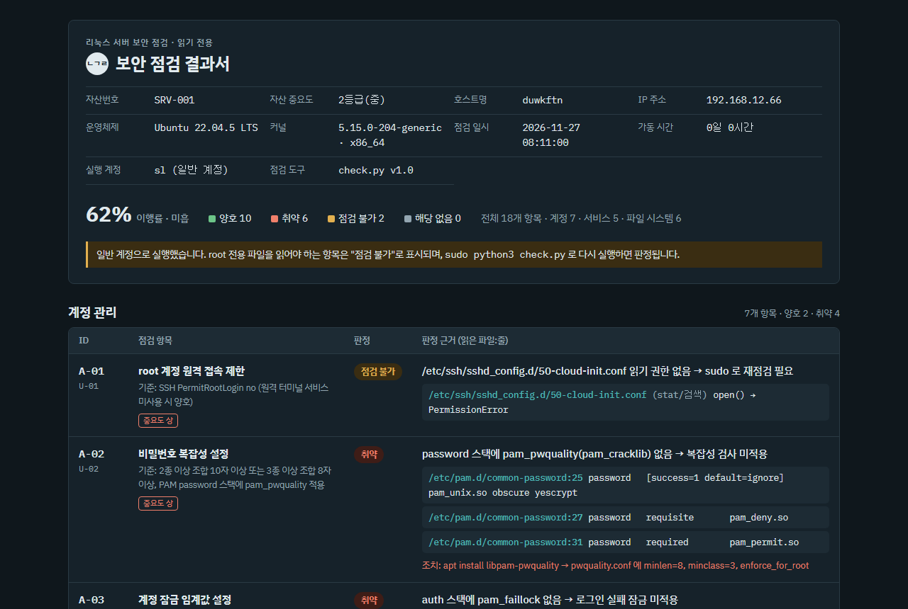

# 리눅스 자산 점검 세트

정보자산 관리 대장, 리눅스 서버 읽기 전용 점검 스크립트(`check.py`), 그 결과로 만든 점검 결과서를 한 세트로 묶었습니다. 자산을 등록하고 중요도를 매긴 다음, 실제 서버를 점검해 결과서를 내기까지의 흐름을 보여 줍니다.

**▶ 데모:** https://duwkftn.github.io/report/  ·  **직무:** 시스템 보안 · 취약점 진단  ·  **형태:** Python 3 스크립트(표준 라이브러리만 사용) + 단일 HTML



## 이 프로젝트에서 보여 주는 것

- 계정 7 · 서비스 5 · 파일 시스템 6, 모두 18개 항목을 점검하는 **Python 스크립트(약 770줄)**. 항목은 KISA 주요정보통신기반시설 취약점 분석·평가 기준의 Unix 항목(U-01 등)을 참고했습니다.
- **읽기 전용 원칙**: 설정 파일은 읽기만 하고, 권한·소유자는 `os.stat()`으로 확인합니다. 외부 명령을 실행하지 않고, 열린 포트는 `/proc/net/*`를 읽어 판단합니다.
- 항목마다 판정(양호/취약/점검 불가)과 **근거(읽은 파일:줄)**를 남겨 결과를 검증할 수 있게 했습니다.
- 자산 관리 대장의 C·I·A 점수 → 중요도 등급이 결과서의 대상 자산 정보로 이어집니다.

## 파일

| 파일 | 내용 |
|---|---|
| `index.html` | 데모 첫 화면 (아래 두 화면으로 이동) |
| `assets.html` | 정보자산 관리 대장. C·I·A 점수(1~3)를 고르면 중요도 등급(합산 또는 최댓값 방식)을 계산합니다. 첫 자산 SRV-001이 실습용 리눅스 서버입니다. |
| `check.py` | 리눅스 서버 읽기 전용 점검 스크립트 |
| `report.html` | 실습용 서버(SRV-001, Ubuntu 22.04)에서 `check.py`를 실행해 만든 점검 결과서. 끝부분에 관리적·기술적 관점, 이행 여부, 총평을 담은 점검 결과표가 있습니다. |
| `result.json` | 같은 결과의 JSON |

## 점검 항목과 실습 서버 결과

| 분류 | 항목 | 결과 |
|---|---|---|
| 계정 | A-01 root 원격 접속 제한 · A-02 비밀번호 복잡성 · A-03 계정 잠금 임계값 · A-04 shadow 사용 · A-05 root 이외 UID 0 금지 · A-06 비밀번호 최대 사용기간 · A-07 세션 종료 시간 | 양호 2 · 취약 4 · 점검 불가 1 |
| 서비스 | S-01 Telnet · S-02 FTP · S-03 r 계열 · S-04 SNMP · S-05 SSH 빈 비밀번호 로그인 금지 | 양호 4 · 점검 불가 1 |
| 파일 시스템 | F-01 /etc/passwd 권한 · F-02 /etc/shadow 권한 · F-03 /etc/hosts 권한 · F-04 world writable 파일 · F-05 hosts.equiv/.rhosts · F-06 UMASK | 양호 4 · 취약 2 |

"점검 불가"는 일반 사용자 권한으로 실행해 root 전용 파일을 읽지 못한 항목입니다. `sudo`로 다시 실행하면 판정됩니다.

## 실행

```
python3 check.py --asset-id SRV-001 --grade "2등급(중)" --out report.html --json result.json
sudo python3 check.py      # root 전용 설정 파일까지 점검
```

스크립트는 파일을 읽기만 하고 시스템 설정을 바꾸지 않습니다. 디스크에 쓰는 파일은 결과서(`--out`, `--json`)뿐입니다.

---

만든 사람: 너구리(ㄴㄱㄹ)
